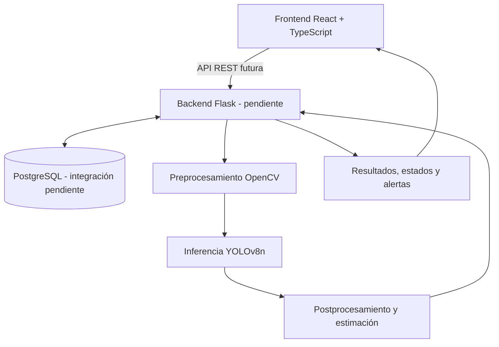

# 🛒 R.E.G.O.V.A.

**Reposición Eficiente de Góndolas mediante Operación con Visión Artificial**

> Sistema en desarrollo para detectar y localizar espacios vacíos en góndolas de supermercados y estimar su disponibilidad observable por nivel de estantería mediante visión computacional.

## 1. Descripción del proyecto

### Problemática

En el comercio minorista, la falta de productos visibles en góndola puede afectar la experiencia de compra y dificultar la reposición oportuna. La inspección manual demanda tiempo del personal y puede retrasar la respuesta frente a quiebres de stock o ubicaciones con baja visibilidad.

**Contexto:** proyecto académico Capstone desarrollado a partir de una necesidad planteada por Walmart Chile.

### Objetivo general

Diseñar e implementar progresivamente una solución de visión computacional capaz de identificar espacios vacíos y estimar el porcentaje de disponibilidad observable en góndolas, diferenciando niveles de estantería y reforzando la toma de decisiones de reposición.

### Propuesta de valor

Complementar la clasificación binaria «vacío / no vacío» con información cuantitativa y localizada que facilite la interpretación del estado de exhibición y, una vez integrada la solución con la operación real, apunte a decisiones más ágiles y útiles para el personal de tienda.

> **Alcance de la medición:** la disponibilidad observable describe lo visible en una imagen. No equivale necesariamente al inventario físico de la tienda ni permite confirmar productos ocultos detrás de otros elementos.

## 2. Funcionalidades y estado de desarrollo

| Componente | Descripción | Estado en Fase 2 |
| --- | --- | --- |
| Mapa digital de góndolas | Organización de la estructura góndola → estante → región de exhibición. | Interfaz funcional con datos de demostración; persistencia integrada pendiente de validación. |
| Gestión de usuarios y acceso | Inicio y cierre de sesión, administración de usuarios y permisos por rol. | Flujos probados en frontend; existe una incidencia de autorización en la configuración de usuarios. |
| Preprocesamiento de imágenes | Módulos Python para preparar imágenes y explorar correcciones geométricas. | Código experimental disponible; eficacia en imágenes difíciles pendiente de validación. |
| Visión computacional | Inferencia con YOLOv8n y estimación experimental de ocupación/disponibilidad visible. | Pesos y demostraciones de inferencia disponibles; métricas consolidadas y validación con datos reales pendiente. |
| Postprocesamiento | Interpretación de resultados visuales y clasificación por criterios operacionales. | Módulos Python disponibles; integración completa pendiente. |
| Panel de supervisión y revisión | Visualización de estados, resultados y acciones de revisión. | Interfaz funcional con datos simulados; conexión con análisis real pendiente. |
| Alertas de reposición | Estados operacionales y eventual seguimiento de alertas. | Reglas e interfaces previstas; flujo completo de alertas no validado. |
| API REST Flask | Comunicación entre frontend, procesamiento visual y persistencia. | **No iniciada (0 %).** |
| Persistencia PostgreSQL | Almacenamiento estructurado de configuración, análisis y alertas. | Diseño/esquema documentado; funcionamiento integrado extremo a extremo pendiente de comprobar. |

### Estados operacionales previstos

**Normal**, **Atención**, **Crítico** y **Revisión requerida**. Los umbrales, incluida cualquier referencia al 30 %, son criterios configurables o sujetos a validación con el cliente; no se consideran conclusiones definitivas del sistema.

## 3. Estrategia técnica

### Tecnologías

| Área | Tecnologías | Uso |
| --- | --- | --- |
| Frontend | React, TypeScript, Vite | Interfaz web y flujos de usuario implementados. |
| Visión computacional | Python, PyTorch, Ultralytics YOLOv8n | Experimentación e inferencia visual. |
| Tratamiento de imágenes | OpenCV, NumPy, Pillow | Preprocesamiento y transformaciones. |
| Persistencia | PostgreSQL | Base de datos prevista; integración pendiente. |
| API REST | Python, Flask | **Tecnología seleccionada, todavía no implementada.** |
| Experimentación | Google Colab y entornos locales | Notebooks, pruebas e inferencias. |

Flask-SQLAlchemy y Psycopg2 pueden evaluarse como dependencias de la futura capa de acceso a datos, pero **no se declaran instalados ni integrados** en esta fase.

### Arquitectura objetivo (no implementada en su totalidad)



**Situación actual:** el frontend y el pipeline experimental de visión se pueden demostrar **por separado**. No existe todavía un flujo completo React → Flask → modelo → PostgreSQL → Reposición.

### Flujo funcional previsto

1. Configurar góndolas, estantes y regiones de exhibición.
2. Recibir una imagen de la góndola.
3. Aplicar preprocesamiento cuando corresponda.
4. Ejecutar la inferencia y estimar disponibilidad observable.
5. Interpretar el resultado según reglas operacionales y marcar casos dudosos para revisión.
6. Presentar resultados y, cuando exista la integración, almacenarlos y generar alertas.

## 4. Evidencias disponibles y validación

### Frontend

Se realizaron pruebas manuales de casos de uso sobre la interfaz en construcción. El equipo dispone del video **`Testing Front.mp4`** como evidencia de ejecución. Entre los flujos revisados se encuentran la configuración, la supervisión y la revisión de estados.

**Incidencia conocida:** usuarios con roles de reponedor o supervisor pueden modificar y guardar configuraciones que deberían reservarse a administradores. La corrección de permisos está pendiente.

### Visión artificial

Se dispone de notebooks, scripts, pesos del modelo y salidas experimentales de inferencia. Las pruebas realizadas muestran el funcionamiento preliminar del procesamiento visual; **no se declaran métricas finales ni robustez validada para producción**.

La grabación explicativa adicional del módulo de visión artificial está **pendiente de incorporación**.

### Evidencias por adjuntar o enlazar

- Video `Testing Front.mp4` y registro de casos de uso.
- Notebooks, imágenes de entrada/salida y registros de ejecución del módulo de visión.
- Archivo de pesos utilizado en las demostraciones.
- Esquema de base de datos, si corresponde.
- Pruebas de integración y API, **cuando estos componentes existan**.

> Los archivos citados deben enlazarse desde este README una vez confirmada su ruta dentro del repositorio o la carpeta compartida. No se incluyen enlaces ficticios.

## 5. Limitaciones y riesgos

- **Ángulos y distorsiones:** pueden reducir la calidad de detección y dificultar la separación por estantes.
- **Reflejos, sombras y baja resolución:** pueden producir estimaciones poco confiables.
- **Oclusiones:** impiden observar completamente una región; se contempla el estado «Revisión requerida».
- **Brecha de dominio:** los conjuntos públicos no representan necesariamente las condiciones reales de las cámaras de tienda.
- **Restricciones de cómputo:** requieren ajustar tamaño de imagen, batch y configuración según el entorno.
- **Integración pendiente:** todavía no existe API Flask ni comunicación completa entre módulos.
- **Permisos de usuario:** se detectó una incidencia funcional en el control de acceso a la configuración.

## 6. Próximos pasos

1. Implementar la API REST en Flask desde cero y definir contratos de entrada/salida.
2. Conectar el frontend con la API y el módulo de visión computacional.
3. Verificar el esquema PostgreSQL y su integración con los resultados reales.
4. Corregir las restricciones de permisos según los roles definidos.
5. Ampliar las pruebas con imágenes difíciles y documentar métricas reproducibles.
6. Incorporar la demostración audiovisual del módulo de visión y consolidar la evidencia de casos.
7. Ejecutar pruebas de integración de extremo a extremo y documentar instalación y ejecución verificadas.

## 7. Ejecución y reproducibilidad

**Importante:** en esta etapa no existe una instalación unificada del sistema. El frontend y el módulo experimental de visión se ejecutan de forma independiente. No se incluye un comando de arranque completo para todo el ecosistema.

Para el frontend, una vez ubicado en su carpeta real y con Node.js instalado:

```bash
npm install
npm run dev
```

Para el módulo de visión, consultar los notebooks y las dependencias incluidas en la carpeta correspondiente. Los comandos de instalación y las rutas definitivas deben verificarse con el repositorio real y la documentación asociada.

## 8. Estado de la entrega

**Fase 2 — desarrollo en curso.** R.E.G.O.V.A. cuenta con una interfaz demostrable y un módulo experimental de visión artificial. El objetivo de la siguiente etapa es conectar ambos componentes con una API y una capa de persistencia funcional, reforzando la trazabilidad y la validación operativa del sistema.

---

*Proyecto académico Capstone — REGOVA. Este documento distingue explícitamente funcionalidades implementadas, experimentales y planificadas.*
