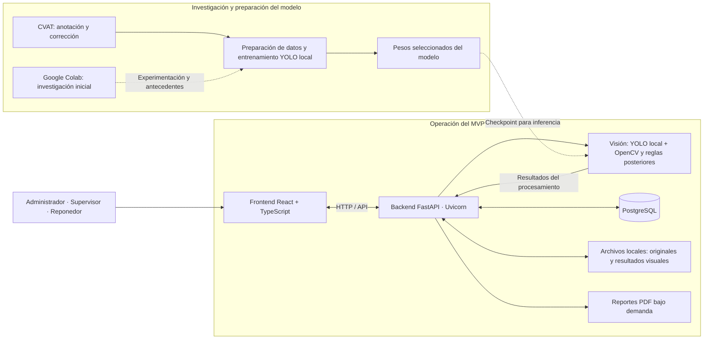

🛒 R.E.G.O.V.A.

**Reposición Eficiente de Góndolas mediante Operación con Visión Artificial**

MVP académico para analizar fotografías de góndolas, detectar productos y vacíos visibles y estimar su ocupación como apoyo a la reposición.

**Actualización documental:** 16 de noviembre de 2026 · Alineada con la propuesta del proyecto v1.2.

## 1. Descripción del proyecto

### Problemática y contexto

La falta de productos visibles en góndola puede afectar la experiencia de compra y dificultar la reposición oportuna. La inspección manual demanda tiempo y requiere interpretar espacios, obstrucciones y condiciones de exhibición.

REGOVA es un proyecto académico Capstone desarrollado a partir de una necesidad planteada por Walmart Chile. Su alcance actual es un **MVP de operación local**, con tres actores funcionales: **Administrador, Supervisor y Reponedor**. Una futura validación en tienda constituye una etapa distinta de la construcción del MVP.

### Objetivo general

Implementar una solución de visión computacional que analice fotografías de góndolas, localice productos y vacíos visibles, estime superficie y ocupación útil cuando exista una base suficiente, y presente evidencia para apoyar las decisiones de reposición del personal.

### Propuesta de valor

Combinar detecciones visuales, regiones definidas por fotografía e indicadores cuantitativos con revisión humana y seguimiento de alertas. La solución distingue **superficie vacía** de **espacio útil estimado**: una separación visible no siempre permite colocar otro producto.

El análisis describe lo observable en una captura. No confirma inventario oculto, profundidad disponible, seguridad de apilamiento ni stock físico de toda la tienda.

## 2. Funcionalidades y estado del MVP

La aplicación actual integra interfaz, API, procesamiento visual y persistencia. La tabla describe capacidades presentes en el código revisado; no sustituye pruebas de aceptación ni certifica desempeño en producción.

| Componente | Alcance actual | Estado y observaciones |
| --- | --- | --- |
| Fotografía y contexto | Carga de JPG, PNG o WEBP, pasillo, fecha, referencia, observaciones y número opcional de estantes. | Flujo disponible en frontend y API, con validación de entradas. |
| Regiones por captura | Región de interés opcional, estructuras y zonas excluidas sobre la fotografía. | Reemplaza la configuración permanente de góndolas. Sin región, puede analizarse la imagen completa con advertencia. |
| Usuarios y acceso | Cuentas, inicio y cierre de sesión, recuperación y permisos por rol y local. | Backend con sesiones y datos en PostgreSQL. La recuperación por correo depende de la configuración SMTP. |
| API | Validación, autorización y coordinación de análisis, reportes y alertas. | **Implementada con FastAPI y Uvicorn.** Flask corresponde a una selección anterior. |
| Visión computacional | Inferencia YOLO y tratamiento de imágenes con OpenCV. | Integrada mediante un subproceso Python local que utiliza los pesos seleccionados. |
| Reglas posteriores | Filtrado por región, tratamiento de detecciones, superficies, frentes y posiciones útiles. | Integradas. La estimación de capacidad útil sigue requiriendo validación y criterio humano. |
| Resultados y reportes | Evidencia visual, indicadores, clasificación, historial y PDF individual o agrupado. | Recorrido disponible en la aplicación; consultar un resultado guardado no requiere repetir la inferencia. |
| Alertas de reposición | Consulta, asignación, atención y cierre como No procede con motivo. | Backend e interfaz incluyen el seguimiento y la trazabilidad del cierre. |
| Revisión humana del resultado | Registro de confirmación, corrección documentada o descarte conservando la predicción, según RF10 y CU08. | La API dispone de esta función; el recorrido completo en la interfaz debe comprobarse o completarse. No equivale a cerrar una alerta como No procede. |
| Persistencia | Datos en PostgreSQL e imágenes en almacenamiento local. | Integrada. La recuperación de evidencia requiere conservar ambos componentes. |

### Clasificación de la captura

- **Crítica:** ocupación igual o inferior al umbral crítico.
- **Baja:** ocupación superior al umbral crítico e inferior al umbral suficiente.
- **Aceptable:** ocupación igual o superior al umbral suficiente.
- **No evaluable:** no existe una base válida para calcular el indicador.

Los umbrales se configuran sin reentrenar el detector, respetando `0 < crítico < suficiente ≤ 100`. No constituyen una conclusión universal sobre la operación de una tienda. Los resultados guardados conservan su clasificación original.

### Estados de la alerta

La atención sigue el recorrido **Pendiente → En atención → Atendida**. El Reponedor toma una alerta sin asignar y registra la atención de una alerta propia.

**No procede** es un cierre sin reposición, disponible según permisos. Exige un motivo de 3 a 1000 caracteres y conserva revisor y fecha. No elimina el análisis ni equivale a marcar la reposición como atendida. El Reponedor puede aplicarlo sobre alertas sin asignar o propias; Administrador y Supervisor revisan las de su ámbito local.

La clasificación de una captura, el estado de una alerta y la revisión humana del resultado son registros diferentes.

## 3. Estrategia técnica y arquitectura

### Tecnologías

| Área | Tecnologías | Uso |
| --- | --- | --- |
| Frontend | React, TypeScript y Vite | Interfaz, desarrollo y compilación. |
| Backend | Python, FastAPI, Uvicorn y Pydantic | API, validaciones y coordinación de servicios. |
| Visión | YOLO con Ultralytics y PyTorch | Entrenamiento e inferencia en un entorno Python específico. |
| Imágenes y cálculos | OpenCV, NumPy y Pillow | Preparación, máscaras, filtros y cálculos geométricos. |
| Persistencia | PostgreSQL y psycopg | Cuentas, sesiones, configuración, análisis, alertas y trazabilidad. |
| Evidencia visual | Almacenamiento local de archivos | Imágenes originales y resultados visuales referenciados por la base. |
| Reportes | ReportLab | Generación de PDF. |
| Pruebas | Vitest, React Testing Library y pytest | Comprobaciones de interfaz, API y lógica con entradas controladas. |
| Preparación del modelo | CVAT, Google Colab y entornos locales | CVAT para anotación y corrección; Colab para investigación inicial; entorno local para entrenamiento y evaluación. |

### Arquitectura lógica actual



Los bloques representan responsabilidades lógicas. No implican microservicios o servidores independientes. FastAPI puede servir el frontend compilado cuando existe su distribución `dist`; durante el desarrollo, Vite y el backend se ejecutan por separado.

La inferencia YOLO se ejecuta en un **subproceso Python local** con sus dependencias y checkpoint. El entorno denominado `.venv-train` también puede utilizarse para inferencia: separar entrenamiento y operación no significa que se pueda eliminar ese entorno ni los pesos activos.

Google Colab forma parte de la investigación y el desarrollo inicial. La aplicación no necesita llamar a Colab para cada análisis. **CVAT prepara anotaciones; no entrena el modelo.** Los ajustes de umbrales, regiones y reglas posteriores tampoco equivalen a reentrenar YOLO.

El código conserva una línea base heurística como antecedente y alternativa técnica. El flujo principal del frontend solicita YOLO; la heurística no se presenta como el entrenamiento del detector ni se confunde con las reglas geométricas posteriores.

### Flujo funcional

1. Autenticar al usuario y comprobar sus permisos.
2. Cargar una fotografía con pasillo y fecha de captura; agregar contexto opcional.
3. Delimitar, si se requiere, región de interés, estructuras y exclusiones. El número de estantes es opcional y debe ser entero entre 1 y 20 cuando se informa.
4. Revisar los datos y ejecutar el análisis.
5. Obtener detecciones y aplicar las reglas posteriores correspondientes.
6. Calcular indicadores, declarar su base y clasificar el resultado.
7. Conservar resultados y evidencia; generar una alerta si se cumple el umbral crítico.
8. Consultar la evidencia y gestionar la atención o el cierre justificado de la alerta.

No se exige configurar previamente una estructura permanente de góndola. Las regiones se definen sobre cada captura.

## 4. Indicadores y límites de interpretación

### Superficie

La ocupación por superficie usa el área ocupada dividida por la suma de área ocupada y vacía. Las categorías estructural, excluida y desconocida no integran esa base.

La tabla de distribución de superficies utiliza el total del área analizada, incluidas categorías no evaluables. Por eso sus porcentajes no tienen la misma base que la ocupación de la superficie evaluable.

### Ocupación útil estimada

Cuando existe una referencia útil evaluada, el indicador usa:

```text
Ocupación útil (%) = frentes ocupados / (frentes ocupados + posiciones útiles libres) × 100
```

Las referencias geométricas se consideran por sector y no deben reducirse para forzar que quepan. Las posiciones propuestas requieren comprobar el tipo de producto y las condiciones físicas de exhibición.

Un valor de 100 % de ocupación útil estimada significa que el procedimiento no propuso posiciones útiles libres en la vista analizada. No acredita stock completo, profundidad ocupada ni ausencia de errores del detector.

La confianza de una detección no es una medición de exactitud del sistema. Los indicadores operacionales tampoco sustituyen las métricas de evaluación del modelo.

## 5. Evidencias y validación

El proyecto dispone de código de pruebas automatizadas y registros de campañas sobre frontend, API y lógica de visión. También conserva herramientas de entrenamiento, pesos y resultados experimentales. Las cifras de cada campaña deben consultarse junto con su fecha, código y alcance; no se mezclan ejecuciones de versiones distintas como un total único vigente.

Las pruebas automatizadas permiten verificar reglas, validaciones y regresiones. No certifican por sí mismas la precisión del detector sobre cualquier góndola, la capacidad física de reposición o la robustez para producción.

La documentación actualizada comprende:

- Propuesta del proyecto v1.2.
- Catálogo de 16 requerimientos funcionales y 14 no funcionales.
- Catálogo y fichas de 14 casos de uso.
- Historias de usuario, épicas y planificación revisada de referencia.
- Mockups de la interfaz implementada, identificando datos ilustrativos.
- Diagramas de casos de uso y arquitectura actualizados.

Las ubicaciones y enlaces de estas evidencias deben corresponder a los archivos efectivamente publicados en el repositorio. Este README no inventa rutas de GitHub ni confirma la publicación de los archivos locales.

### Comprobaciones pendientes de aceptación

- Verificar o completar el registro de revisión humana desde la interfaz, además de su ruta en la API.
- Conciliar la matriz de permisos del panorama: la propuesta v1.2 lo asigna a Administrador y Supervisor, mientras el frontend también lo habilita al Reponedor.
- Consolidar la evaluación del modelo con fotografías etiquetadas y separadas del entrenamiento.
- Contrastar las propuestas de espacio útil con referencias manuales y productos apilables y no apilables.
- Repetir y documentar pruebas de navegador, integración, rendimiento y recuperación de respaldos según el entorno de entrega.

Estas observaciones reemplazan las afirmaciones antiguas de que la API no existe o de que todos los componentes funcionan únicamente por separado.

## 6. Limitaciones del MVP

- La perspectiva, las sombras, los reflejos y la resolución pueden producir falsos positivos u omisiones.
- Las oclusiones limitan lo observable; pueden requerir exclusiones o revisión del personal. No generan necesariamente un estado automático denominado Revisión requerida.
- Los conjuntos utilizados para aprendizaje no representan todas las góndolas o condiciones de una tienda.
- El espacio útil es una estimación geométrica frontal: no acredita soporte, seguridad, apilabilidad ni profundidad disponible.
- Las capturas históricas pueden utilizar bases de cálculo distintas; no deben compararse como si midieran siempre la misma magnitud o una única góndola.
- El MVP opera en un ámbito local. Su instalación en otro equipo requiere preparar dependencias, base, archivos y modelo.
- No se declara captura continua, reposición física automática, integración con inventario comercial ni operación productiva validada.

## 7. Ejecución y reproducibilidad

Los accesos siguientes corresponden a la **distribución local de la aplicación revisada**. Si este repositorio Capstone contiene principalmente documentación, primero debe ubicarse la carpeta del código de REGOVA; no se presupone que estos archivos estén en la raíz del repositorio académico.

### Uso diario en un equipo preparado

Desde la carpeta de la aplicación, ejecutar:

```bat
ejecutables\INICIAR_REGOVA.bat
```

El acceso realiza comprobaciones y abre la aplicación local, normalmente en `http://127.0.0.1:8011`. Se mantiene abierta la consola mientras se utiliza el sistema.

### Preparación de otro equipo

Consultar las instrucciones incluidas en `ejecutables/README.md` y `BACKEND_REGOVA.md` dentro de la distribución del código. La preparación contempla Python, PostgreSQL, dependencias de aplicación e inferencia, checkpoint y configuración local. El asistente disponible es `ejecutables/PREPARAR_EQUIPO.bat`.

Una copia del repositorio no garantiza incluir imágenes, credenciales, respaldo de base de datos o pesos privados. Para recuperar una instalación con evidencia, deben conservarse la base, sus archivos asociados y el modelo necesario. El envío de recuperación por correo requiere configuración SMTP válida.

### Desarrollo del frontend

Desde la distribución del código, el arranque directo del backend se encuentra en `ejecutables/EJECUTAR.bat`. En otra consola, `ejecutables/INICIAR_FRONTEND.bat` inicia Vite. Son entornos de desarrollo de una solución integrada, no la antigua situación de módulos sin API.

No se deben iniciar `EJECUTAR.bat` e `INICIAR_REGOVA.bat` como dos servidores simultáneos sobre el mismo puerto. La interfaz compilada se actualiza con `npm run build` desde la raíz de la aplicación.

### Pruebas

La distribución dispone de `ejecutables/EJECUTAR_QA.bat` para la campaña frontend y de `scripts/run_backend_qa.py` para backend y algoritmo con PostgreSQL temporal. Consultar las instrucciones de testing y los informes de la campaña correspondiente antes de interpretar cobertura o cantidades de pruebas.

No se publican contraseñas, archivos `.env`, tokens ni copias de la base operativa como parte de las evidencias del repositorio.

## 8. Evolución y próximos pasos

La versión inicial contemplaba un mapa permanente de góndolas, Flask como tecnología seleccionada y módulos demostrables por separado. La solución actual trabaja con regiones por fotografía e integra React, FastAPI, inferencia local YOLO, PostgreSQL y archivos de evidencia.

La evolución se justifica por la necesidad de adaptar el área de análisis a cada captura, distinguir superficie de espacio útil y mantener trazabilidad de resultados y decisiones humanas. Colab se conserva como antecedente de investigación; CVAT pertenece a la preparación de datos, y el entrenamiento produce los pesos usados en inferencia.

Los siguientes pasos se concentran en cerrar las comprobaciones de aceptación, evaluar precisión y capacidad útil con referencias independientes, mantener coherencia entre documentos y permisos, y verificar reproducibilidad en el equipo de entrega. Las fechas y los estados de sprints deben respaldarse con los registros reales del equipo.

---

*Proyecto académico Capstone — REGOVA. MVP con flujo central integrado; capacidades experimentales y validación pendiente se indican expresamente. La versión documental no certifica un despliegue en producción.*
